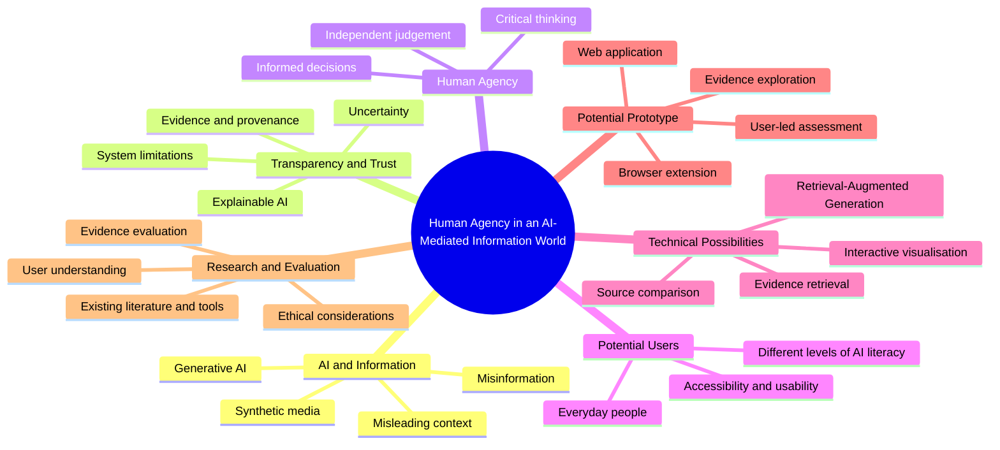

# Week 2 — Critical Studies: Literature Review

## 1. Project Direction

Following Week 1, I have begun narrowing my interests in artificial intelligence towards transparency, misinformation and human agency. I am particularly interested in how everyday people can evaluate information in an increasingly AI-mediated world without becoming overly dependent on automated decisions.

Rather than committing to a final product immediately, I want to use academic research and experimentation to identify a meaningful problem and develop a technically ambitious response.

## 2. Project Proposal: Human Agency in an AI-Mediated Information World

Artificial intelligence is increasingly shaping how people encounter, interpret and share information. Generative AI can produce convincing text, images and other media, making it increasingly important to evaluate the reliability and context of digital content. However, identifying whether content was generated by AI is not the same as establishing whether it is accurate or misleading.

This project will investigate how interactive design can help everyday users critically evaluate AI-mediated information, understand uncertainty and retain agency over their judgements. It will explore AI literacy, explainable AI, misinformation and human–computer interaction, particularly in relation to people with varying levels of technical knowledge.

The intended outcome is an interactive digital prototype, potentially developed as a web application or browser extension. One technical possibility is Retrieval-Augmented Generation (RAG), which retrieves relevant information from external sources before an AI model generates a response. The interface could enable users to explore supporting evidence, compare sources and recognise conflicting information or limitations, rather than relying on a definitive AI-generated verdict. This approach would require careful evaluation because retrieved information can be incomplete, unreliable or misinterpreted.

Existing research will inform the project's development. Almatrafi, Johri and Lee (2024) review approaches to AI literacy, while Laato et al. (2022) investigate how AI systems can be explained to end users. Frau-Meigs (2024) considers media and information literacy in the context of generative AI.

A preliminary research gap to investigate is whether making evidence and uncertainty explorable through an interactive system helps everyday users make better-informed judgements than receiving a conventional AI-generated answer alone. Further literature review and analysis of existing tools will be necessary to establish the scope of this gap.

Ultimately, the project aims to explore how creative computing can support responsible AI use while preserving human judgement, autonomy and informed decision-making.

## 3. Annotated Bibliography

### Source 1: AI Literacy

**Reference**

Almatrafi, O., Johri, A. and Lee, H. (2024) ‘A systematic review of AI literacy conceptualization, constructs, and implementation and assessment efforts (2019–2023)’, *Computers and Education Open*, 6, article 100173. Available at: https://doi.org/10.1016/j.caeo.2024.100173.

**Summary of the source**

This systematic literature review examines 47 articles published between 2019 and August 2023 to investigate how AI literacy is defined, developed and assessed. The authors identify six key constructs: recognising AI, knowing and understanding it, using and applying it, evaluating it, creating with it, and navigating it ethically.

**Critical evaluation and relevance**

This source provides a research-based framework for considering the knowledge and skills people need to engage critically with AI systems. It could inform the design and evaluation criteria of my proposed prototype, particularly when considering how users assess AI-mediated information. However, the review examines AI literacy research rather than directly testing misinformation interfaces. Its search period also ends in August 2023, meaning further research is needed to account for subsequent developments in generative AI and related interactive tools.

**How I will use it**

I will use the review to identify relevant dimensions of AI literacy and investigate how these might translate into practical interface features and evaluation criteria. I will also explore more focused research on misinformation, evidence presentation and user judgement before deciding on the prototype's final functionality.

## 4. Synthesis of Sources

AI literacy research considers the knowledge and skills people need to engage critically with AI, while explainable AI research examines how systems communicate their behaviour and outputs to users. Media and information literacy extends these concerns to the wider information environment, where people must evaluate sources and make informed decisions. Together, these perspectives motivate investigating whether an interactive system can connect accessible explanations and evidence with users' own evaluation of information.

## 5. Preliminary Research Gap

The gap I intend to investigate is whether making supporting evidence, conflicting information and uncertainty explorable within an interactive AI system helps everyday users make better-informed judgements than receiving a conventional AI-generated answer alone.

This is a provisional research gap, not a claim that no similar systems or studies exist. Further literature review and analysis of existing verification tools will be necessary to establish what has already been attempted, which limitations remain, and how my project could make a distinct contribution.

## 6. Initial Mind Map

The following mind map represents my current areas of exploration. It is an initial research map rather than a final design, and the relationships between its themes may change as the project develops.

## 7. References

Almatrafi, O., Johri, A. and Lee, H. (2024) ‘A systematic review of AI literacy conceptualization, constructs, and implementation and assessment efforts (2019–2023)’, *Computers and Education Open*, 6, article 100173. Available at: https://doi.org/10.1016/j.caeo.2024.100173 (Accessed: 9 October 2026).

Frau-Meigs, D. (2024) *User empowerment through media and information literacy responses to the evolution of generative artificial intelligence (GAI).* UNESCO. Available at: https://unesdoc.unesco.org/ark:/48223/pf0000388547 (Accessed: 9 October 2026).

Laato, S., Tiainen, M., Islam, A.K.M.N. and Mäntymäki, M. (2022) ‘How to explain AI systems to end users: a systematic literature review and research agenda’, *Internet Research*, 32(7), pp. 1–31. Available at: https://doi.org/10.1108/INTR-08-2021-0600 (Accessed: 9 October 2026).
