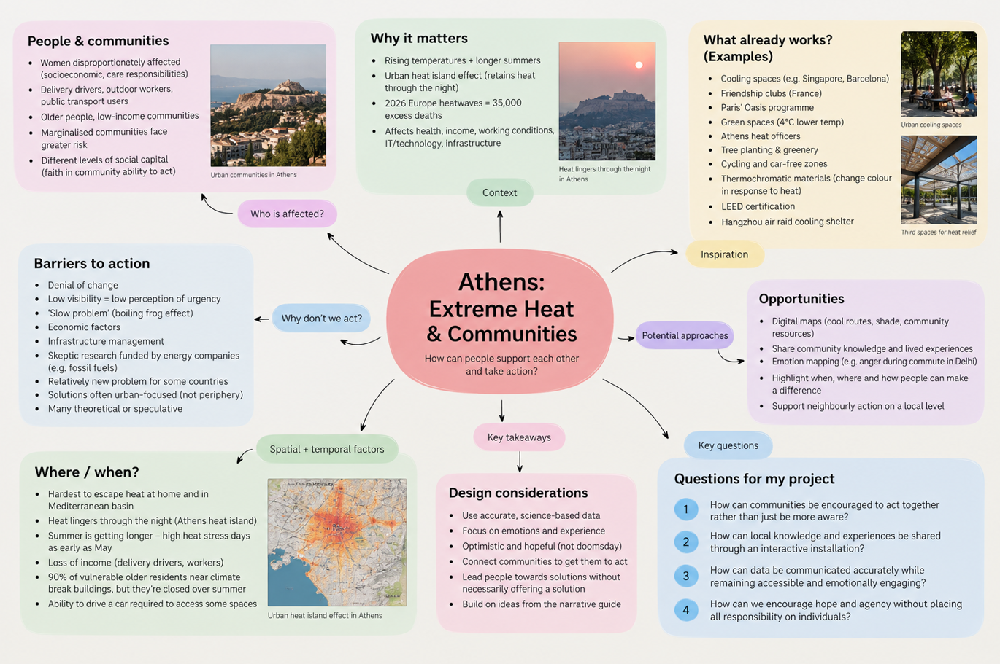

# Week 3 — Research Reflection: Extreme Heat and Collective Action

I couldn't attend the Jason Bruges Studio visit on 13 October, but I reviewed the notes shared from the session and thought about how they could inform my understanding of the HeatLab project.

## Key Reflections

One point that stood out to me was that people already know extreme heat is a problem. The bigger challenge is helping them understand what they can do about it. Rather than focusing only on raising awareness, the project should help people identify practical opportunities to prepare and support one another.

Community connection also seems important. Examples such as friendship clubs, cooling spaces and cool routes show how sharing knowledge and making local support more accessible could help people respond to extreme heat. However, communities have different resources and levels of social connection, so any approach should consider who might be left out.

The project should also balance scientific evidence with personal experience. Accurate data can explain the scale of the problem, while people's experiences can show how heat affects everyday life differently. The aim should be to communicate these realities without exaggeration or making people feel that the situation is hopeless.

## Questions and Responses

**1. How can communities be encouraged to act together rather than simply become more aware of extreme heat?**

By making collective action feel practical and achievable. An interactive installation could help people discover local resources, share useful knowledge or identify ways to support vulnerable neighbours. The focus would be on helping people see what they can do together, rather than simply telling them that heat is dangerous.

**2. How could local knowledge and people's experiences be shared through an interactive installation?**

A digital map could allow people to explore local experiences of heat, such as uncomfortable walking routes, areas with little shade or places where people can find relief. Personal experiences could sit alongside scientific data, helping people understand how the same heatwave affects different communities. This would need to be designed carefully so that participation is accessible and people's privacy is respected.

**3. How can scientific data be communicated accurately while remaining accessible and emotionally engaging?**

The installation could use clear visualisations, relevant statistics and real experiences rather than overwhelming people with technical information. Any figures should come from reliable sources and be presented in context. Personal stories could make the information more relatable without exaggerating the evidence.

**4. How can a project encourage hope and collective action without implying that individual or community action alone can solve the wider heat crisis?**

It could highlight realistic actions communities can take while acknowledging that infrastructure, working conditions and urban planning also affect people's exposure to heat. The aim would be to show that collective action can make a meaningful difference without suggesting that responsibility for the entire crisis falls on individuals.

## Initial Research Mind Map

This mind map created on Figma brings together my initial research into extreme heat in Athens, including the communities affected, barriers to collective action, existing approaches and potential opportunities for creative engagement. This visual mind map brings together the key themes, ideas and questions surrounding extreme heat in Athens, helping me organise the information and identify connections between community experiences, existing approaches and opportunities for collective action.

## Next Steps

The HeatLab discussions made me think about how creative technology can help people and communities access information, share knowledge and feel more confident taking action, rather than becoming overwhelmed by complex issues. This connects to my own thesis idea of developing accessible software to help non-technical users, particularly older adults, distinguish AI-generated content from human-created content, exploring how technology can improve digital understanding, reduce confusion and help people make more informed decisions in an increasingly AI-driven society. I am particularly interested in whether technology could help people feel more connected to their communities and more capable of taking action, rather than leaving them feeling overwhelmed by the scale of the problem.
